<p>
<picture>
  <source media="(prefers-color-scheme: light)" srcset="assets/banner/hero-v2-light.svg">
  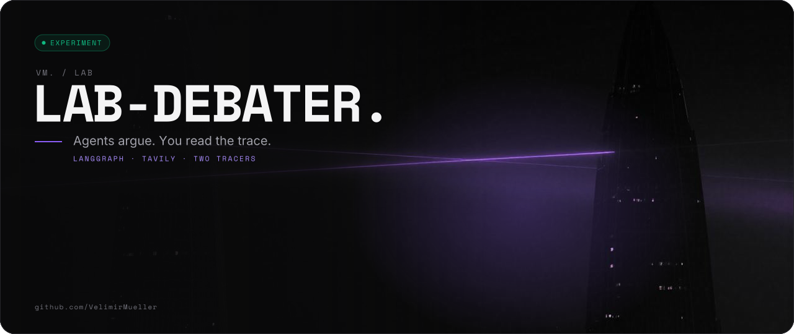
</picture>
</p>

<p>
<picture>
  <source media="(prefers-color-scheme: light)" srcset="assets/readme/lead-v2-light.svg">
  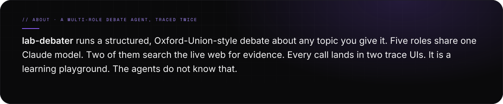
</picture>
</p>

<p>
<picture>
  <source media="(prefers-color-scheme: light)" srcset="assets/readme/stats-v2-light.svg">
  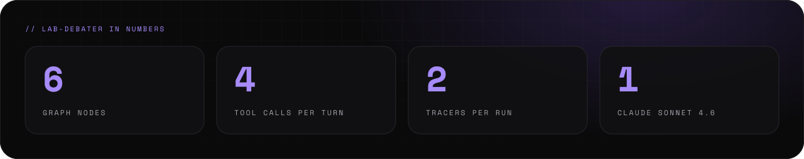
</picture>
</p>

<br>

<p>
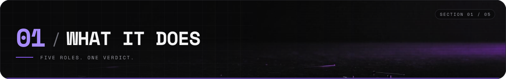
</p>

<p>
<picture>
  <source media="(prefers-color-scheme: light)" srcset="assets/readme/features-v2-light.svg">
  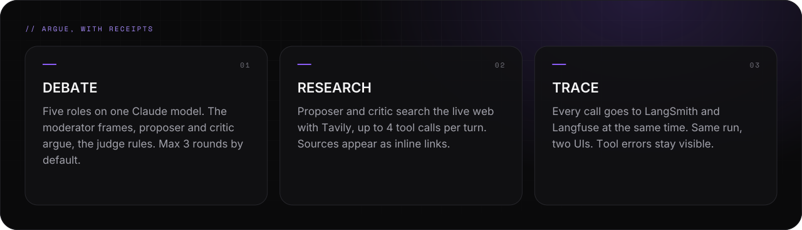
</picture>
</p>

<p>
<picture>
  <source media="(prefers-color-scheme: light)" srcset="assets/readme/what-v2-light.svg">
  
</picture>
</p>

<br>

<p>
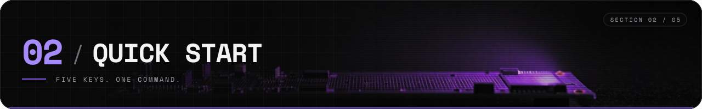
</p>

<p>
<picture>
  <source media="(prefers-color-scheme: light)" srcset="assets/readme/start-v2-light.svg">
  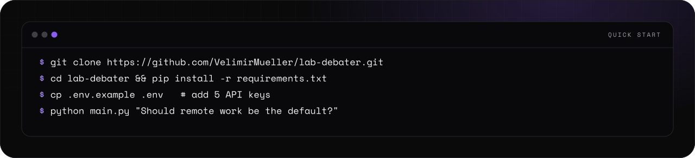
</picture>
</p>

<p>
<picture>
  <source media="(prefers-color-scheme: light)" srcset="assets/readme/keys-v2-light.svg">
  
</picture>
</p>

<p align="center">
<a href="https://console.anthropic.com"><picture><source media="(prefers-color-scheme: light)" srcset="assets/readme/links-1-v2-light.svg"></picture></a>
<a href="https://smith.langchain.com"><picture><source media="(prefers-color-scheme: light)" srcset="assets/readme/links-2-v2-light.svg"></picture></a>
<a href="https://cloud.langfuse.com"><picture><source media="(prefers-color-scheme: light)" srcset="assets/readme/links-3-v2-light.svg">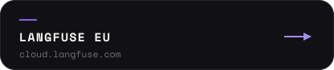</picture></a>
</p>

<p align="center">
<a href="https://us.cloud.langfuse.com"><picture><source media="(prefers-color-scheme: light)" srcset="assets/readme/links-4-v2-light.svg">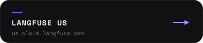</picture></a>
<a href="https://tavily.com"><picture><source media="(prefers-color-scheme: light)" srcset="assets/readme/links-5-v2-light.svg">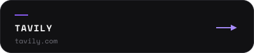</picture></a>
</p>

<p>
<picture>
  <source media="(prefers-color-scheme: light)" srcset="assets/readme/setup-v2-light.svg">
  
</picture>
</p>

<details>
<summary><picture><source media="(prefers-color-scheme: light)" srcset="assets/readme/links-14-v2-light.svg"></picture></summary>

```bash
# clone, enter
git clone https://github.com/VelimirMueller/lab-debater.git
cd lab-debater

# Python 3.13+ (ideally via uv, pyenv, or a PyCharm venv)
python -m venv .venv
source .venv/bin/activate  # or .venv\Scripts\activate on Windows
pip install -r requirements.txt

# keys
cp .env.example .env
# edit .env and paste in ANTHROPIC_API_KEY, LANGSMITH_API_KEY,
# LANGFUSE_PUBLIC_KEY, LANGFUSE_SECRET_KEY, TAVILY_API_KEY.
# Leave the other fields as-is. main.py will fail fast if any required key is missing.

# run
python main.py "Should remote work be the default for knowledge workers?"
```

</details>

<p>
<picture>
  <source media="(prefers-color-scheme: light)" srcset="assets/readme/privacy-v2-light.svg">
  
</picture>
</p>

<br>

<p>
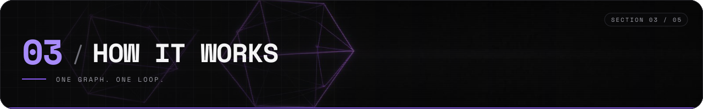
</p>

<p>
<picture>
  <source media="(prefers-color-scheme: light)" srcset="assets/readme/flow-v2-light.svg">
  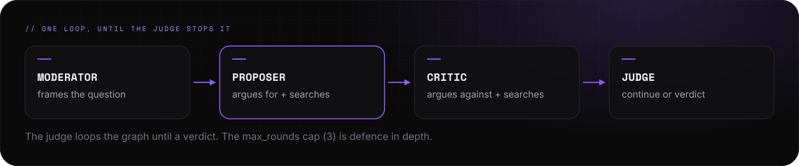
</picture>
</p>

<p>
<picture>
  <source media="(prefers-color-scheme: light)" srcset="assets/readme/graph-v2-light.svg">
  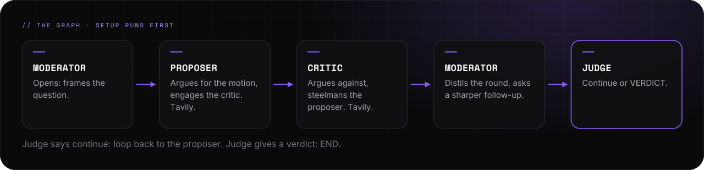
</picture>
</p>

<p>
<picture>
  <source media="(prefers-color-scheme: light)" srcset="assets/readme/how-v2-light.svg">
  
</picture>
</p>

<p align="center">
<a href="docs/REFERENCE.md"><picture><source media="(prefers-color-scheme: light)" srcset="assets/readme/links-6-v2-light.svg">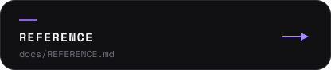</picture></a>
<a href="docs/superpowers/specs/"><picture><source media="(prefers-color-scheme: light)" srcset="assets/readme/links-7-v2-light.svg">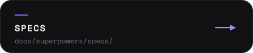</picture></a>
<a href="docs/superpowers/plans/"><picture><source media="(prefers-color-scheme: light)" srcset="assets/readme/links-8-v2-light.svg">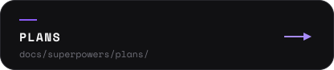</picture></a>
</p>

<br>

<p>
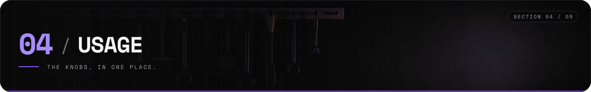
</p>

<p>
<picture>
  <source media="(prefers-color-scheme: light)" srcset="assets/readme/tools-v2-light.svg">
  
</picture>
</p>

<p>
<picture>
  <source media="(prefers-color-scheme: light)" srcset="assets/readme/env-v2-light.svg">
  
</picture>
</p>

<p>
<picture>
  <source media="(prefers-color-scheme: light)" srcset="assets/readme/structure-v2-light.svg">
  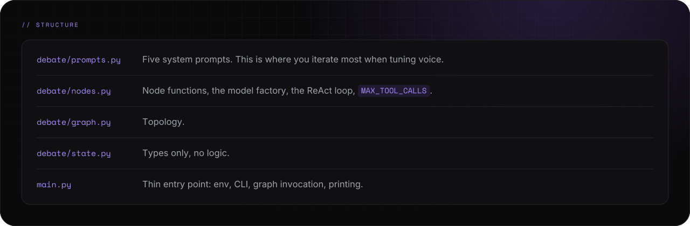
</picture>
</p>

<p>
<picture>
  <source media="(prefers-color-scheme: light)" srcset="assets/readme/scope-v2-light.svg">
  
</picture>
</p>

<p align="center">
<a href="docs/superpowers/specs/2026-04-21-tavily-tool-use-design.md"><picture><source media="(prefers-color-scheme: light)" srcset="assets/readme/links-9-v2-light.svg">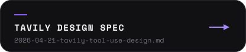</picture></a>
<a href="https://pypi.org/project/langchain-tavily/"><picture><source media="(prefers-color-scheme: light)" srcset="assets/readme/links-10-v2-light.svg"></picture></a>
<a href="debate/tools.py"><picture><source media="(prefers-color-scheme: light)" srcset="assets/readme/links-11-v2-light.svg">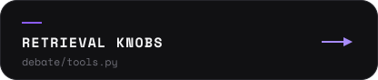</picture></a>
</p>

<br>

<p>
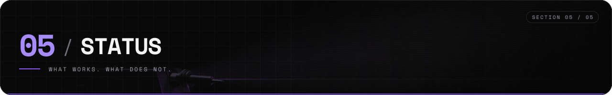
</p>

<p>
<picture>
  <source media="(prefers-color-scheme: light)" srcset="assets/readme/status-v2-light.svg">
  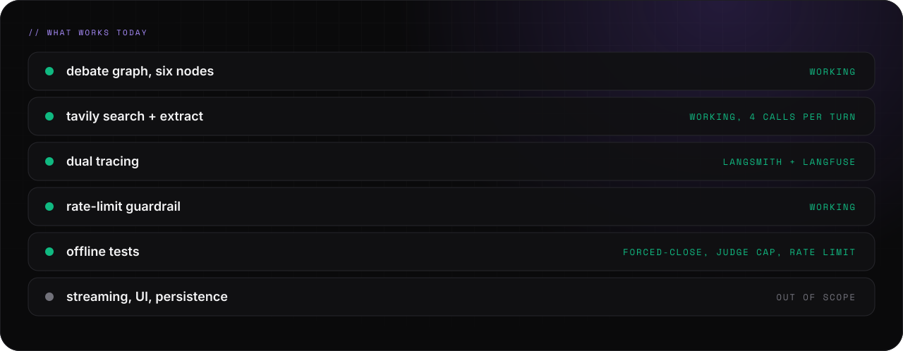
</picture>
</p>

<p>
<picture>
  <source media="(prefers-color-scheme: light)" srcset="assets/readme/tests-v2-light.svg">
  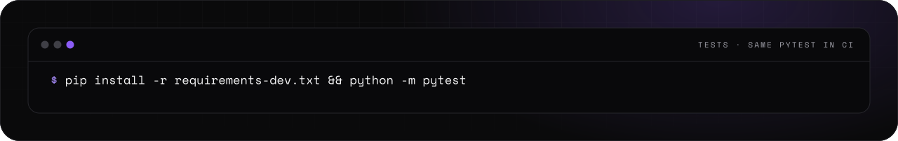
</picture>
</p>

<details>
<summary><picture><source media="(prefers-color-scheme: light)" srcset="assets/readme/links-14-v2-light.svg"></picture></summary>

```bash
pip install -r requirements-dev.txt && python -m pytest
```

</details>

<p>
<picture>
  <source media="(prefers-color-scheme: light)" srcset="assets/readme/ci-v2-light.svg">
  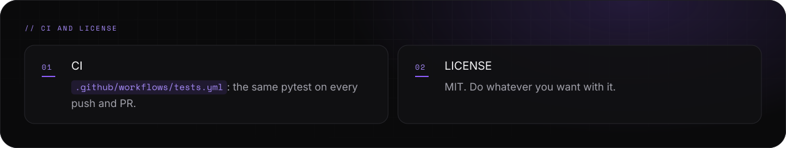
</picture>
</p>

<p align="center">
<a href=".github/workflows/tests.yml"><picture><source media="(prefers-color-scheme: light)" srcset="assets/readme/links-12-v2-light.svg">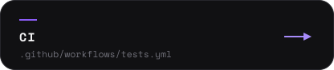</picture></a>
<a href="LICENSE"><picture><source media="(prefers-color-scheme: light)" srcset="assets/readme/links-13-v2-light.svg">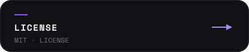</picture></a>
</p>

<p>
<picture>
  <source media="(prefers-color-scheme: light)" srcset="assets/readme/footer-v2-light.svg">
  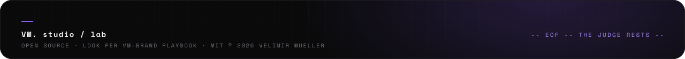
</picture>
</p>
