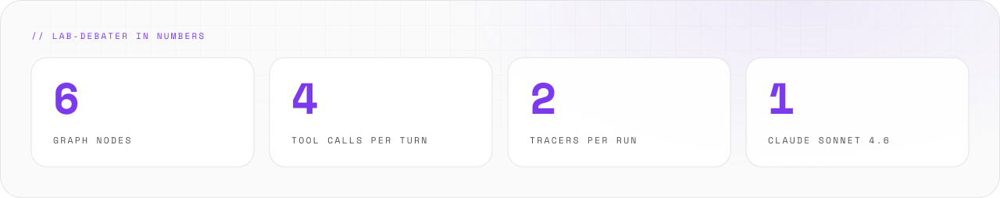
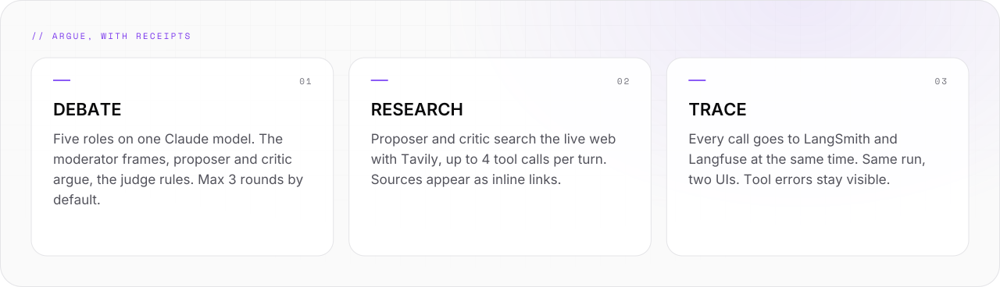
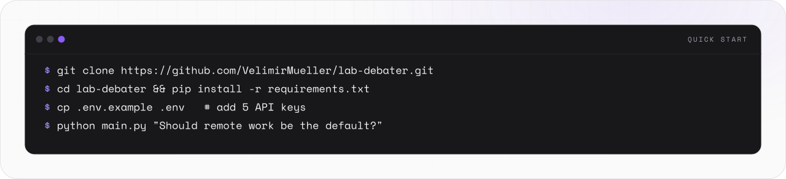
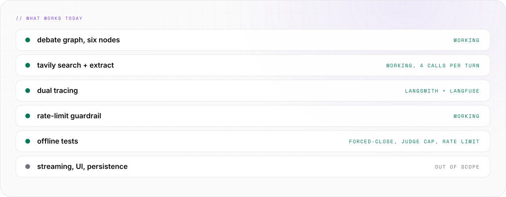

<picture>
  <source media="(prefers-color-scheme: light)" srcset="assets/banner/hero-v2-light.svg">
  
</picture>

<p align="center">

[](#-05-status) [](https://github.com/VelimirMueller) [](LICENSE) [](#-02-quick-start)

</p>

> Agents argue. You read the trace.

```text
██       ████   █████
██      ██  ██  ██  ██
██      ██████  █████
██      ██  ██  ██  ██
██████  ██  ██  █████
█████   ██████  █████    ████   ██████  ██████  █████
██  ██  ██      ██  ██  ██  ██    ██    ██      ██  ██
██  ██  █████   █████   ██████    ██    █████   █████
██  ██  ██      ██  ██  ██  ██    ██    ██      ██ ██
█████   ██████  █████   ██  ██    ██    ██████  ██  ██  ██

 ------  a multi-role debate agent, traced twice  --------
```

**lab-debater** runs a structured, Oxford-Union-style debate about any topic you give it.
Five roles share one Claude model. Two of them search the live web for evidence.
Every call lands in two trace UIs. It is a learning playground. The agents do not know that.

<picture>
  <source media="(prefers-color-scheme: dark)" srcset="assets/readme/stats-v2-dark.svg">
  
</picture>

<br>

## // 01 WHAT IT DOES


<picture>
  <source media="(prefers-color-scheme: dark)" srcset="assets/readme/features-v2-dark.svg">
  
</picture>

- Five roles share one **Claude Sonnet 4.6** model. Each role has its own system prompt and temperature.
- The moderator opens with a sharp focus question, then distils each round into agreement, disagreement and a sharper follow-up.
- The proposer argues for, the critic argues against. Both engage the other side directly. Both have research tools.
- Each debater turn runs a ReAct loop: up to `MAX_TOOL_CALLS = 4` calls to `tavily_search` / `tavily_extract`, then prose. Sources appear inline as `[claim](https://url)` links.
- The judge ends each round: continue, or emit a verdict. An optional `max_rounds` cap (default 3) is defence in depth.
- Output: the full transcript, a `VERDICT:` line, and both trace URLs. An excerpt is in [docs/REFERENCE.md](docs/REFERENCE.md).

<br>

## // 02 QUICK START


<picture>
  <source media="(prefers-color-scheme: dark)" srcset="assets/readme/start-v2-dark.svg">
  
</picture>

Four accounts, five keys:

- **Anthropic** — [console.anthropic.com](https://console.anthropic.com). One full debate costs about $0.10–0.20 on Sonnet 4.6 with tools, about $0.05 without.
- **LangSmith** — [smith.langchain.com](https://smith.langchain.com). Free tier: 5k traces per month.
- **Langfuse** — [cloud.langfuse.com](https://cloud.langfuse.com) (EU) or [us.cloud.langfuse.com](https://us.cloud.langfuse.com) (US). Free tier: 50k observations per month.
- **Tavily** — [tavily.com](https://tavily.com). Free tier: 1,000 credits per month, one credit per basic search or extract. One debate budgets ≤ 24 calls, so 40+ debates fit.

```bash
# clone, enter
git clone https://github.com/VelimirMueller/lab-debater.git
cd lab-debater

# Python 3.13+ (ideally via uv, pyenv, or a PyCharm venv)
python -m venv .venv
source .venv/bin/activate  # or .venv\Scripts\activate on Windows
pip install -r requirements.txt

# keys
cp .env.example .env
# edit .env and paste in ANTHROPIC_API_KEY, LANGSMITH_API_KEY,
# LANGFUSE_PUBLIC_KEY, LANGFUSE_SECRET_KEY, TAVILY_API_KEY.
# Leave the other fields as-is. main.py will fail fast if any required key is missing.

# run
python main.py "Should remote work be the default for knowledge workers?"
```

### What leaves your machine

- Tracing is **on by default**: `LANGSMITH_TRACING=true` in `.env.example`, plus the Langfuse callback in `main.py` (`build_run_config()`).
- Every run sends the topic, all prompts, every model reply and the raw Tavily results — including full page text from `tavily_extract` — to LangSmith and Langfuse. Do not debate anything you would not paste into those dashboards.
- Set `LANGSMITH_TRACING=false` to run without LangSmith.
- Scraped pages go back into the model as tool results, so a page can carry instructions aimed at the LLM (indirect prompt injection). Acceptable for a local toy with read-only tools. Keep it in mind before giving the agent tools that act.

<br>

## // 03 HOW IT WORKS


<picture>
  <source media="(prefers-color-scheme: dark)" srcset="assets/readme/flow-v2-dark.svg">
   PROPOSER -> CRITIC -> JUDGE. The judge loops the graph until a verdict. The max_rounds cap (3) is defence in depth." src="assets/readme/flow-v2-light.svg" width="100%">
</picture>

```text
 setup ─▶ moderator (opens: frames the question)
              │
   ┌─────────────────────┐
   │ proposer  ▸ tavily  │  argues for the motion,
   │     │               │  engages the critic
   │     ▼               │
   │ critic    ▸ tavily  │  argues against, steelmans
   │     │               │  the proposer
   │     ▼               │
   │ moderator (distill) │  distils the round, asks
   │     │               │  a sharper follow-up
   │     ▼               │
   │ judge               │  continue or VERDICT
   └────────┬────────────┘
            │ yes: loop back to proposer
            ▼ no
           END
```

- One LangGraph `StateGraph`, six nodes, one conditional edge. The moderator is one function registered at two positions (`moderator_open`, `moderator_distill`); it branches on `len(transcript) == 0`.
- Termination lives in state, not in a counter: `verdict: str | None` is the single source of truth. The judge parses its own output to set it. `max_rounds` is defence in depth.
- ReAct loops run inside the debater nodes (`_run_with_tools()` in [debate/nodes.py](debate/nodes.py)). Moderator, judge and setup stay pure-LLM — they arbitrate structure, not evidence.
- Each LLM call carries a `run_name` like `proposer-argument-r1`. ReAct iterations add `-iter0`, `-iter1`, …
- Design history: [docs/superpowers/specs/](docs/superpowers/specs/) and [docs/superpowers/plans/](docs/superpowers/plans/). Full reference: [docs/REFERENCE.md](docs/REFERENCE.md).

<br>

## // 04 USAGE


### The research tools

- `tavily_search` — 4 results with `title`, `url` and a ~500-char snippet. Usually the first call of a turn.
- `tavily_extract` — the full page as clean markdown. For when a snippet is too thin for a proper quote.
- Both come from [langchain-tavily](https://pypi.org/project/langchain-tavily/). Retrieval knobs live in one place, [debate/tools.py](debate/tools.py): `max_results=4`, `search_depth="basic"`, `include_answer=False`.
- At the cap, the loop forces one clean close with the tools still bound and `tool_choice={"type": "none"}` — Anthropic rejects a history with `tool_use` blocks when no tools are defined.
- Tool errors do not crash the debate. They surface as `ToolMessage(content="Tool error: ...")` and stay visible in both tracers. The rate-limit day is not hidden.

### Environment

`.env.example` documents every key and its default:

- `ANTHROPIC_API_KEY`, `TAVILY_API_KEY` — the model and the search.
- `LANGSMITH_TRACING`, `LANGSMITH_API_KEY`, `LANGSMITH_PROJECT`, `LANGSMITH_ENDPOINT` — LangSmith. EU accounts must set the EU endpoint; a wrong region means 403 on `/runs/multipart` uploads.
- `LANGFUSE_PUBLIC_KEY`, `LANGFUSE_SECRET_KEY`, `LANGFUSE_HOST` — Langfuse.
- `RATE_LIMIT_MAX_RETRIES`, `RATE_LIMIT_MAX_SLEEP_SECONDS`, `RATE_LIMIT_BASE_SLEEP_SECONDS` — the 429 guardrail in [debate/rate_limit.py](debate/rate_limit.py). It honours the `retry-after` header, backs off exponentially otherwise, and stacks on the Anthropic SDK's own retries (default 2 per call): a long 429 storm costs up to 3 × (`RATE_LIMIT_MAX_RETRIES` + 1) requests.

### Structure

- [debate/prompts.py](debate/prompts.py) — five system prompts. This is where you iterate most when tuning voice.
- [debate/nodes.py](debate/nodes.py) — node functions, the model factory, the ReAct loop, `MAX_TOOL_CALLS`.
- [debate/graph.py](debate/graph.py) — topology. [debate/state.py](debate/state.py) — types only, no logic.
- [main.py](main.py) — thin entry point: env, CLI, graph invocation, printing.

### Experiments

Iterations are cheap: edit, run, inspect trace, repeat. Ten documented tweaks — prompts, termination rule, `max_rounds`, `MAX_TOOL_CALLS`, `search_depth="advanced"`, model per role, a new role, tools for the judge — are listed in [docs/REFERENCE.md](docs/REFERENCE.md).

### Scope

- Validation is mostly manual, via traces. `tests/` holds offline regression tests for the forced-close and judge-cap edge paths and the rate-limit guardrail.
- No persistence, no UI, no API (CLI only), no streaming, no tool caching, no cross-turn source dedup, no multi-user sessions.
- Tools are scoped to proposer and critic (Approach 1). Approach 2 — the judge as fact-checker with receipts — is mapped in [the Tavily design spec](docs/superpowers/specs/2026-04-21-tavily-tool-use-design.md), not wired in.
- Fork freely.

<br>

## // 05 STATUS


<picture>
  <source media="(prefers-color-scheme: dark)" srcset="assets/readme/status-v2-dark.svg">
  
</picture>

```bash
pip install -r requirements-dev.txt && python -m pytest
```

- CI — [`.github/workflows/tests.yml`](.github/workflows/tests.yml): the same pytest on every push and PR.
- [LICENSE](LICENSE) — MIT. Do whatever you want with it.

<br>

```text
-- EOF ------------------------------------------- THE JUDGE RESTS --
```

---

<sub>VM. studio / lab · open source · look per <code>vm-brand</code> playbook · [MIT](LICENSE) © 2026 Velimir Mueller</sub>
